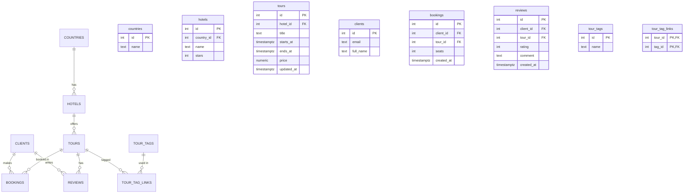

# Турагентство

Тема № __: **Турагентство**. База хранит данные о странах, отелях, турах,
клиентах и их бронированиях; нужна турагентам для учёта продаж.

| | |
| --- | --- |
| Главная таблица | `tours` — туры (отель, даты, цена) |
| Связь N:M | `tours` и `tour_tags` через `tour_tag_links` |
| Бизнес-правило | Цена тура больше нуля, дата окончания позже даты начала |
| СУБД | PostgreSQL 17 в Docker |

## Задания курса

Правила курса, установка и порядок сдачи: [docs/README.md](docs/README.md).

| Лаба | Задание |
| --- | --- |
| 1. Модель данных и схема | [docs/lab-1.md](docs/lab-1.md) |
| 2. Запросы | [docs/lab-2.md](docs/lab-2.md) |
| 3. Логика в базе | [docs/lab-3.md](docs/lab-3.md) |
| 4. Транзакции и доступ | [docs/lab-4.md](docs/lab-4.md) |
| 5. Производительность | [docs/lab-5.md](docs/lab-5.md) |
| Витрина к защите | [docs/showcase.md](docs/showcase.md) |

## Как запустить

```bash
cp .env.example .env          # пароли и порт
docker compose up -d          # при первом запуске выполняются скрипты из db/
dbcheck run demo/lab1.sql     # сценарий лабы 1


## ER-диаграмма

