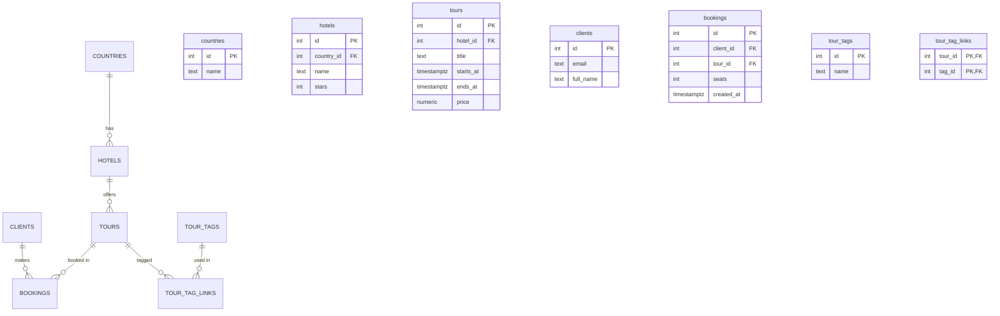

# Турагентство

Тема № __: **Турагентство**. База хранит данные о странах, отелях, турах,
клиентах и их бронированиях; нужна турагентам для учёта продаж.

| | |
| --- | --- |
| Главная таблица | `tours` — туры (отель, даты, цена) |
| Связь N:M | `tours` и `tour_tags` через `tour_tag_links` |
| Бизнес-правило | Цена тура больше нуля, дата окончания позже даты начала |
| СУБД | PostgreSQL 17 в Docker |

## Задания курса

Правила курса, установка и порядок сдачи: [docs/README.md](docs/README.md).

| Лаба | Задание |
| --- | --- |
| 1. Модель данных и схема | [docs/lab-1.md](docs/lab-1.md) |
| 2. Запросы | [docs/lab-2.md](docs/lab-2.md) |
| 3. Логика в базе | [docs/lab-3.md](docs/lab-3.md) |
| 4. Транзакции и доступ | [docs/lab-4.md](docs/lab-4.md) |
| 5. Производительность | [docs/lab-5.md](docs/lab-5.md) |
| Витрина к защите | [docs/showcase.md](docs/showcase.md) |

## Как запустить

```bash
cp .env.example .env          # пароли и порт
docker compose up -d          # при первом запуске выполняются скрипты из db/
dbcheck run demo/lab1.sql     # сценарий лабы 1
```

Работа с базой: `docker compose exec db psql -U postgres -d app`. Сценарии выполняются в `psql` командой `\i /demo/lab1.sql`.

После изменения скриптов в `db/` базу нужно пересоздать: `docker compose down -v && docker compose up -d`.

## ER-диаграмма



Связующая таблица — `tour_tag_links`: два внешних ключа (`tour_id`, `tag_id`)
на разные таблицы, покрытые составным PRIMARY KEY. Реализует связь N:M
между турами и тегами.

## Ограничения

| Ограничение | Таблица и колонки | Зачем |
| --- | --- | --- |
| `UNIQUE` | `clients.email` | Email клиента уникален |
| `UNIQUE` | `countries.name` | Название страны уникально |
| `UNIQUE` | `tour_tags.name` | Название тега уникально |
| `UNIQUE` | `hotels (country_id, name)` | В одной стране нет двух отелей с одним именем |
| `UNIQUE` | `bookings (client_id, tour_id, created_at)` | Один клиент не бронирует один тур дважды в одну секунду |
| `CHECK` | `hotels.stars` | Звёздность отеля от 1 до 5 |
| `CHECK` | `tours.price` | Цена тура больше нуля |
| `CHECK` | `tours (ends_at > starts_at)` | Тур не может кончаться раньше начала |
| `CHECK` | `bookings.seats` | Мест в брони больше нуля |
| `NOT NULL` | Все обязательные поля (см. `db/01_schema.sql`) | Пустые значения запрещены |

## Нормализация

### Плоская таблица (как было бы без нормализации)

| booking_id | client_name | client_email | hotel | country | price | tags |
| --- | --- | --- | --- | --- | --- | --- |
| 1 | Иванов Иван | ivanov@mail.ru | Sun Beach | Турция | 85000 | пляж, all inclusive |
| 2 | Иванов Иван | ivanov@mail.ru | Sun Beach | Турция | 85000 | пляж, all inclusive |
| 3 | Петрова Анна | petrova@mail.ru | Blue Bay | Турция | 45000 | пляж |

Проблемы:

- Имя и email клиента повторяются в каждой его брони. При смене email придётся править много строк.
- Название отеля и страна дублируются.
- Список через запятую в `tags` — нарушение 1НФ (в ячейке не одно значение).

### Разбито до 3НФ

- **1НФ:** теги вынесены в `tour_tags` и связующую `tour_tag_links`.
- **2НФ:** клиент → `clients`, отель → `hotels`, тур → `tours`. Каждый неключевой столбец зависит от PK своей таблицы.
- **3НФ:** страна → `countries`. В `hotels` остался только `country_id`.

### Типы данных

| Данные | Тип | Почему |
| --- | --- | --- |
| Деньги (`price`) | `numeric(10,2)` | `float` хранит приближённо: 0.1 + 0.2 ≠ 0.3 |
| Даты и время | `timestamptz` | Учитывает часовой пояс |
| Страна отеля | FK на `countries` | Справочник, а не строка в каждой строке |

## Что происходит при удалении (ON DELETE)

| Связь | ON DELETE | Причина |
| --- | --- | --- |
| `hotels.country_id → countries.id` | `RESTRICT` | Страну с отелями удалять нельзя |
| `tours.hotel_id → hotels.id` | `RESTRICT` | Тур без отеля бессмысленен |
| `bookings.client_id → clients.id` | `CASCADE` | Удалили клиента — чистим его брони |
| `bookings.tour_id → tours.id` | `RESTRICT` | Тур с бронями удалять нельзя |
| `tour_tag_links.tour_id → tours.id` | `CASCADE` | Связь без тура бессмысленна |
| `tour_tag_links.tag_id → tour_tags.id` | `CASCADE` | Связь без тега бессмысленна |

## Что сделано по лабам

| Лаба | Что сделано | Сценарий |
| --- | --- | --- |
| 1 | 7 таблиц, ключи, ограничения, N:M, тестовые данные | `demo/lab1.sql` |
| 2 | — | `demo/lab2.sql` |
| 3 | — | `demo/lab3.sql` |
| 4 | — | `demo/lab4.sql`, `demo/race.sql`, `demo/race_fixed.sql` |
| 5 | — | `demo/lab5.sql` |